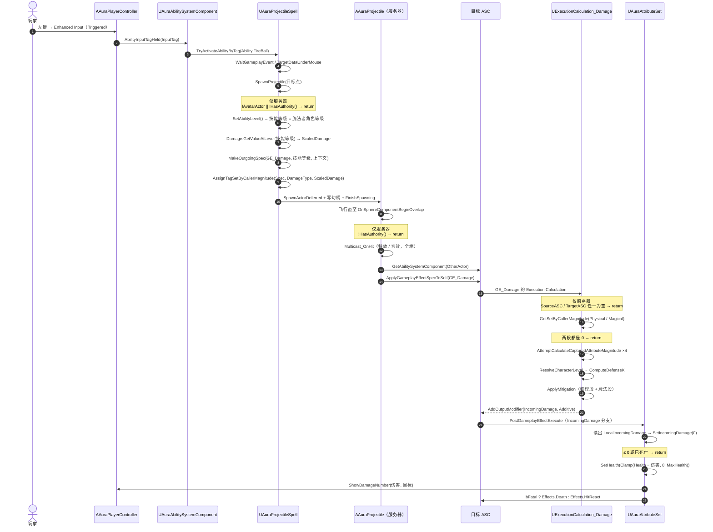

# 伤害结算公式与调用链

_从技能基础伤害 + 攻击力到屏幕上那行黄字 · 服务器结算 / 客户端表现 · AURA / UE 5.8 GAS_

## ① 总览（Mermaid）



> 三个 `Note` 就是整条链路上仅有的三个「出口」：技能不在服务器生成、投射物不在服务器结算、ExecutionCalculation 拿不到双方 ASC。任何一环断了，都不会掉血，也都不会报错。

## ② 计算公式

### A. 三段式

```
① Raw        = 技能基础伤害 + 施法者攻击力 × AttackScaling
② Mitigation = 防御 / (防御 + K)
   K          = DefenseBase + DefensePerLevel × (施法者等级 − 1)
   Final      = Raw × (1 − Mitigation)，且不低于 Raw × MinDamageRatio
③ 输出        IncomingDamage += Final（EGameplayModOp::Additive）
```

> 技能等级 = 施法者角色等级（`UAuraGameplayAbility::SetAbilityLevel`），`Damage` 这条 `FScalableFloat` 按角色等级查 `CT_Damage`：火球 1 级 20 点、10 级 70 点、50 级 300 点。
> K 的等级刻度跟**施法者**、防御数值跟**受击者**——两者分工的原因见 ②D。

物理段、魔法段**各跑一遍 ②③ 再相加**，所以一个技能可以同时携带物理和魔法伤害。

| 段 | 原始伤害 | 参与判定的防御 |
|---|---|---|
| 物理 | `Base_Physical + PhysicalAttack × AttackScaling` | `Armor` |
| 魔法 | `Base_Magical + MagicalAttack × AttackScaling` | `MagicResistance` |

代码：`Source/Aura/Public/AbilitySystem/ExecutionCalculation/ExecutionCalculation_Damage.h:21-88`（三个 `inline` 函数），`Source/Aura/Private/AbilitySystem/ExecutionCalculation/ExecutionCalculation_Damage.cpp:102-148`（取值与调用）。

### B. 第一段：为什么是「加法 + 系数」

| 输入 | 来源 | 作用 |
|---|---|---|
| 技能基础伤害 | `UAuraGameplayAbility::Damage`（`FScalableFloat`）按技能等级查 CurveTable，施法时写进 SetByCaller | 技能之间谁强谁弱 |
| 施法者攻击力 | `PhysicalAttack` / `MagicalAttack` 属性，由职业 MMC 算出 | 同一成长曲线上的属性收益 |

选加算而非乘算（`Base × (1 + Attack×c)`）的理由：

- **解耦**：技能强弱只由 `Base` 决定，属性收益由 `Attack × c` 决定，改一个不动另一个；
- **避免复利**：乘法下高阶技能基础伤害本来就高，再乘攻击力，装备收益被指数放大；
- **便于横向比较**：火球 15 / 陨石 60 直接可比，不用换算成"等效攻击力"。

`AttackScaling` 默认 `0.6` = 攻击力打六折计入，让基础伤害仍占四成左右——前期不至于因为法师物理攻击只有 10.4 就打出个位数。

数值上的副作用是**后期属性占比上升**（元素法师 L1 魔法攻击 71.3、L50 369.2）：同一技能基础伤害从 15 涨到 60 时，攻击力贡献占比从 74% 升到 79%。这符合"装备主导输出"的 ARPG 直觉；若想让技能主导，把 `AttackScaling` 降到 0.2~0.3 即可，结构不用动。

### C. 第二段：为什么用除法减伤

`M = D / (D + K)` 让三个端点同时成立：

| D | 0 | 5 | 10 | 25 | 50 (=K) | 100 | 200 |
|---|---|---|---|---|---|---|---|
| 减伤 | 0% | 9.1% | 16.7% | 33.3% | **50%** | 66.7% | 80% |

- `D = 0` → 裸装吃满伤害；
- `D = K` → 恰好减半，**K 的物理含义就是「减伤到 50% 所需的防御值」**，一个策划能直接用一句话解释的刻度；
- `D → ∞` → 趋近 100% 但永不免疫。

对比减法减伤（`Final = Raw − D`）的三个问题：

1. 会出现负数，必须再 clamp，等于用补丁修设计；
2. 存在阈值：`D ≥ Raw` 后伤害恒 0，坦克对低级怪直接无敌；
3. 边际收益是阶跃的，曲线是折线。

除法还有一个好算的性质——**有效生命**：

```
EHP = HP / (1 − M) = HP × (D + K) / K
∂EHP/∂D = HP / K     ← 与当前防御无关，线性
```

即每点防御带来的"等效血量"是常数，不会前期超值、后期报废。元素法师 L1（HP 145，K=50）每点护甲 = +2.9 有效生命，坦克（HP 612）= +12.2。

### D. K 为什么跟随「施法者」等级

`M = D / (D + K)`：**K 越大，同样的防御减伤越弱**（K 是分母里的常数）。这条等级刻度只能跟施法者等级走。

早先的实现跟的是**受击者等级**，于是每提高一级敌人会出现两件事同时发生：

- 护甲/魔抗按 MMC 只涨 +1.5~+4 点（四职业斜率不同）；
- K 涨了 +10 点。

分母涨得比分子快，减伤比例反而下降。玩家 L1 打敌人 L2，敌人吃到的伤害比 L1 时还多：

| 职业 | 护甲 L1 → L2 | 旧实现受伤倍率（L2/L1） | 新实现受伤倍率 | 新实现 L3/L1 |
|---|---|---|---|---|
| 元素 | 8.4 → 9.2 | **×1.013** | ×0.986 | ×0.973 |
| 游侠 | 12.4 → 13.7 | **×1.016** | ×0.980 | ×0.960 |
| 战士 | 44.1 → 47.6 | **×1.050** | ×0.964 | ×0.931 |
| 坦克 | 66.9 → 71.9 | **×1.064** | ×0.959 | ×0.921 |

改成跟**施法者等级**后，两边的职责就分清了：

- 同级互打：K 与旧实现逐字相同（双方等级相同，刻度相同），已经验证过的数值一个都不用重测；
- 受击者比施法者等级高：护甲更厚、K 不变 → 更抗打；
- 受击者比施法者等级低：护甲更薄、K 更大 → 更脆。

这样「等级」只从一个方向进入分母（施法者），从另一个方向进入分子（受击者的护甲），不会互相抵消掉。

副作用（保留）：四职业护甲斜率不同，共用一个 K 时同级互打的减伤仍会随等级整体下滑（坦克 57.2% → 38.0%）。想稳住就把 `DefensePerLevel` 从 10 调到 3（L50：元素 19.7% / 战士 52.9% / 坦克 62.7%）；想让等级差更陡，则提高护甲 MMC 里的等级系数（`LevelCoefficient`，见 `Docs/PrimaryAttributes_CurveTable.md`），因为等级差现在全靠护甲表达。

### E. 第三段：下限

`D > 9K` 之后减伤会压到 10% 以下，再往上就是"数字在跳、血条不动"。`MinDamageRatio = 0.1` 保证任何目标至少吃 `Raw × 10%`，设为 0 才允许被完全压制。

### F. 参数表

| 参数 | 默认 | 位置 | 调大 | 调小 |
|---|---|---|---|---|
| `AttackScaling` | 0.6 | `ExecutionCalculation_Damage.h:155` | 属性更重要，数值膨胀更快 | 技能更重要，更接近动作游戏 |
| `DefenseBase` | 50 | `ExecutionCalculation_Damage.h:162` | 防御贬值，战斗更快更脆 | 防御升值，更偏持久战 |
| `DefensePerLevel` | 10 | `ExecutionCalculation_Damage.h:170` | 高级施法者打低级目标更痛，同级互打后期更薄 | 同级互打后期减伤更厚 |
| `MinDamageRatio` | 0.1 | `ExecutionCalculation_Damage.h:177` | 高防目标也吃固定伤害 | 允许被完全压制 |

四个都是 `EditDefaultsOnly`，可在 `GE_Damage` 的细节面板里改 CDO，不必重编译。

## ③ 函数调用链

### A. 施法端：算出两样东西并写进 Spec

| 步骤 | 函数 | 位置 | 执行端 |
|---|---|---|---|
| 生成入口 | `UAuraProjectileSpell::SpawnProjectile` | `Source/Aura/Private/AbilitySystem/Abilities/AuraProjectileSpell.cpp:54` | 仅服务器（`:61` 守卫） |
| 取技能等级 | `UAuraGameplayAbility::SetAbilityLevel()`（施法者角色等级，取不到退回 Spec 等级） | `Source/Aura/Private/AbilitySystem/Abilities/AuraGameplayAbility.cpp:22-40` | 仅服务器 |
| 取基础伤害 | `Damage.GetValueAtLevel(AbilityLevel)` | `AuraProjectileSpell.cpp:110` | 仅服务器 |
| 造 Spec | `SourceASC->MakeOutgoingSpec(DamageEffectClass, AbilityLevel, MakeEffectContext())` | `AuraProjectileSpell.cpp:108` | 仅服务器 |
| 写数值 | `AssignTagSetByCallerMagnitude(SpecHandle, DamageType, ScaledDamage)` | `AuraProjectileSpell.cpp:119` | 仅服务器 |
| 塞进投射物 | `Projectile->DamageEffectSpecHandle = SpecHandle` | `AuraProjectileSpell.cpp:120` | 仅服务器 |

**SetByCaller 的 key 就是攻击类型 tag**（`Damage.Type.Physical` / `Damage.Type.Magical`），magnitude 是基础伤害。类型和数值绑定在同一个 tag 上，不会出现"写了伤害忘了类型"的错配。

### B. 命中端：把 Spec 施加到目标

| 步骤 | 函数 | 位置 | 执行端 |
|---|---|---|---|
| 命中判定 | `AAuraProjectile::OnSphereComponentBeginOverlap` | `Source/Aura/Private/Actor/AuraProjectile.cpp:126` | 仅服务器（`:132`） |
| 表现广播 | `Multicast_OnHit(ImpactLocation, ImpactNormal)` | `AuraProjectile.cpp:161` | 全端 |
| 取目标 ASC | `UAbilitySystemBlueprintLibrary::GetAbilitySystemComponent(OtherActor)` | `AuraProjectile.cpp:165` | 仅服务器 |
| 上伤害 | `TargetASC->ApplyGameplayEffectSpecToSelf(*DamageEffectSpecHandle.Data.Get())` | `AuraProjectile.cpp:167` | 仅服务器 |

Spec 由施法者 ASC 创建，因此 `SourceASC = 施法者`、`TargetASC = 被击中者`——ExecutionCalculation 里的 `GetSourceAbilitySystemComponent()` / `GetTargetAbilitySystemComponent()` 就是这两个。

### C. 结算端：ExecutionCalculation

| 步骤 | 函数 | 位置 |
|---|---|---|
| 入口 | `UExecutionCalculation_Damage::Execute_Implementation` | `Source/Aura/Private/AbilitySystem/ExecutionCalculation/ExecutionCalculation_Damage.cpp:53` |
| 取双方 ASC | `ExecutionParams.GetSourceAbilitySystemComponent()` / `GetTargetAbilitySystemComponent()` | `ExecutionCalculation_Damage.cpp:57-58` |
| 读类型数值 | `Spec.GetSetByCallerMagnitude(Tags.Damage_Type_Physical, false, 0.f)` | `ExecutionCalculation_Damage.cpp:89-90` |
| 读施法者攻击 | `AttemptCalculateCapturedAttributeMagnitude(PhysicalAttack/MagicalAttack)` | `ExecutionCalculation_Damage.cpp:110-111` |
| 读目标防御 | `AttemptCalculateCapturedAttributeMagnitude(Armor/MagicResistance)` | `ExecutionCalculation_Damage.cpp:124-125` |
| 反解等级 | `AuraDamageMath::ResolveCharacterLevel(TargetASC->GetAvatarActor(), GE 等级)` | `ExecutionCalculation_Damage.cpp:130-131` |
| 算 K | `AuraDamageMath::ComputeDefenseK(DefenseBase, DefensePerLevel, TargetLevel)` | `ExecutionCalculation_Damage.cpp:132` |
| 减伤 | `AuraDamageMath::ApplyMitigation(Raw, Defense, K, MinDamageRatio)` | `ExecutionCalculation_Damage.cpp:137` / `:141` |
| 输出 | `AddOutputModifier(FGameplayModifierEvaluatedData(GetIncomingDamageAttribute(), Additive, FinalDamage))` | `ExecutionCalculation_Damage.cpp:166-167` |

`GetSetByCallerMagnitude` 的第二个参数传 `false`：一个 Spec 只带其中一种类型是常态，传 `true` 会让引擎对"没找到"发警告，物理命中时每发刷一条。第三个参数传 `0.f`：缺省即该段无伤害，`0` 是加法中性元。

`AttemptCalculateCapturedAttributeMagnitude` 失败时不改写入参，所以两个攻击力变量先置 0——失败自然退化成"只按基础伤害结算"，而不是让整次伤害崩掉。

### D. 属性端：扣血、飘字、受击/死亡

| 步骤 | 函数 | 位置 |
|---|---|---|
| 回调入口 | `UAuraAttributeSet::PostGameplayEffectExecute` | `Source/Aura/Private/AbilitySystem/AuraAttributeSet.cpp:251` |
| 伤害分支 | `Data.EvaluatedData.Attribute == GetIncomingDamageAttribute()` | `AuraAttributeSet.cpp:282` |
| 取值即清零 | `const float LocalIncomingDamage = GetIncomingDamage(); SetIncomingDamage(0.f);` | `AuraAttributeSet.cpp:284-285` |
| 丢弃非正/已死 | `if (LocalIncomingDamage <= 0.f) return;` / `if (GetHealth() <= 0.f) return;` | `AuraAttributeSet.cpp:287` / `:289` |
| 扣血 | `SetHealth(FMath::Clamp(GetHealth() - LocalIncomingDamage, 0.f, GetMaxHealth()))` | `AuraAttributeSet.cpp:297-298` |
| 飘字 | `AAuraPlayerController::ShowDamageNumber(LocalIncomingDamage, TargetCharacter)` | `AuraAttributeSet.cpp:302-306` |
| 受击/死亡 | `bFatal ? Effects.Death : Effects.HitReact → TargetASC->TryActivateAbilitiesByTag(...)` | `AuraAttributeSet.cpp:310-314` |

> `IncomingDamage` 是 Meta 属性（不复制、不持久化），每次结算后被清零，只作为一个"传递伤害数字"的信封。它让**所有伤害来源（近战、投射物、DOT、环境）收敛到同一个出口**，飘字、受击动画、死亡判定只需要写一次。

## ④ 数值验证

技能基础伤害为示例值（真实值来自 `GA_*` 的 `FScalableFloat` 曲线），属性取自 `Docs/PrimaryAttributes_CurveTable.md`。

| 场景 | 计算 | 结果 |
|---|---|---|
| L1 元素法师火球 → L1 坦克 | `Raw = 15 + 71.3×0.6 = 57.8`；`M = 30.4/(30.4+50) = 37.8%` | **35.9**（坦克 612 HP ≈ 18 发） |
| 同上，物理普攻 | `Raw = 8 + 10.4×0.6 = 14.2`；`M = 66.9/(66.9+50) = 57.2%` | **6.1**（是火球的 1/6） |
| L1 法师火球 → L1 法师 | `Raw = 57.8`；`M = 13.4/63.4 = 21.1%` | **45.6**（145 HP ≈ 4 发） |
| L50 法师火球 → L50 坦克 | `K = 50+10×49 = 540`；`Raw = 60 + 369.2×0.6 = 281.5`；`M = 199.6/739.6 = 27.0%` | **205.5**（2962 HP ≈ 15 发） |

第三行说明物理/魔法走不同防御是刻意的：法师普攻对坦克只有 6 点，符合职业分工，不是 bug。

技能等级改成「施法者角色等级」后，同一发火球的伤害会随角色等级直接跳档：`CT_Damage` 上 `Abilities.FireBall` 在 1/5/10/15/20/50 级分别是 20/40/70/100/140/300，中间线性插值。所以「角色升到 10 级」带来的变化不只是属性涨，技能基础伤害也从 20 变成 70——上表的 L1 数字不再适用于 L10。

## ⑤ 边界与扩展点

当前**有意未做**的部分：

| 未做 | 现状 | 建议扩展位置 |
|---|---|---|
| 暴击 | `CriticalChance` 属性存在但本类不掷骰 | 减伤后乘倍率；掷骰放在施加 GE 之前 |
| 命中 / 闪避 | `HitChance` / `DodgeChance` 未参与 | 投射物命中判定前判定，Miss 就不 Apply |
| 等级差修正 | 已由「K 跟施法者等级 + 护甲接受击者等级」体现（见 ②D） | 想让等级差更陡：`Raw` 之后乘等级差系数，或提高护甲 MMC 的等级系数 |
| 防御穿透 | 无 | `Raw` 之前从 `Defense` 里扣除 |
| 物魔分离 K | 两段共用同一个 `DefenseK` | 拆成两个 UPROPERTY |
| 属性易伤 | 无 | 按 `Damage.Type.*` tag 在最终值上乘倍率 |

两条容易忽略的语义（`ExecutionCalculation_Damage.h:87-89`）：

- **源属性 `snapshot = true`**：攻击力在施法那一刻定格，投射物飞行途中施法者吃减攻 buff 不影响这一发；
- **目标属性 `snapshot = false`**：防御在命中瞬间取最新值，所以飞行途中套上的护盾有效。

日志：`DEFINE_LOG_CATEGORY_STATIC(LogAuraDamage, Log, All)`（`ExecutionCalculation_Damage.cpp:36`），每次命中一条 Log 级记录；想看"为什么这次没结算"，运行时敲 `log LogAuraDamage Verbose` 打开三个提前返回分支的诊断。

## ⑥ 相关文件索引

- `Source/Aura/Public/AbilitySystem/ExecutionCalculation/ExecutionCalculation_Damage.h:21-88` —— 公式本体（`AuraDamageMath` 三个 inline 函数）
- `Source/Aura/Public/AbilitySystem/ExecutionCalculation/ExecutionCalculation_Damage.h:98-113` —— 四个属性捕获定义（`snapshot` 语义）
- `Source/Aura/Public/AbilitySystem/ExecutionCalculation/ExecutionCalculation_Damage.h:141-178` —— 四个可调参数
- `Source/Aura/Private/AbilitySystem/ExecutionCalculation/ExecutionCalculation_Damage.cpp:44-51` —— 构造函数登记捕获属性
- `Source/Aura/Private/AbilitySystem/ExecutionCalculation/ExecutionCalculation_Damage.cpp:53-171` —— 完整结算流程
- `Source/Aura/Private/AbilitySystem/Abilities/AuraProjectileSpell.cpp:54-114` —— 伤害 Spec 的创建（基础伤害写入点）
- `Source/Aura/Private/AbilitySystem/Abilities/AuraGameplayAbility.cpp:22-40` —— `SetAbilityLevel`：技能等级 = 施法者角色等级
- `Source/Aura/Private/Actor/AuraProjectile.cpp:126-173` —— 命中与上伤害
- `Source/Aura/Private/AbilitySystem/AuraAttributeSet.cpp:251-317` —— `PostGameplayEffectExecute`：扣血 / 飘字 / 受击 / 死亡
- `Source/Aura/Public/AbilitySystem/Abilities/AuraGameplayAbility.h:43-47` —— `Damage`（`FScalableFloat`）与 `DamageType`
- `Content/Blueprint/AbilitySystem/GameplayEffects/GE_Damage.uasset` —— 必须为 Instant 且挂本 Execution Calculation
- `Docs/DamageText_CallChain.md` —— 飘字之后的下游（从 `ShowDamageNumber` 到屏幕像素）
- `Docs/PrimaryAttributes_CurveTable.md` —— 四职业属性与 MMC 系数来源
