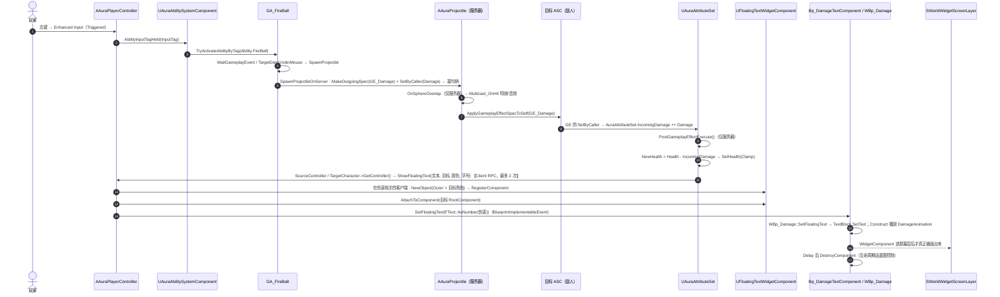

# 伤害飘字（Damage Number）调用链

_从鼠标左键到屏幕上那行黄字 · 服务器结算 / 客户端表现 · AURA / UE 5.8 GAS_

## ① 总览（Mermaid）



## ② 逐段拆解

### A. 输入 → 技能激活（客户端 + 服务器）

| 步骤 | 函数 | 位置 | 执行端 |
|---|---|---|---|
| 输入映射 | `MoveAction` / `IA_* → GameplayTag` | `Source/Aura/Public/Player/AuraPlayerController.h:100-109` | 客户端 |
| 绑定 | `BindAbilityActions(AuraInputConfig, …)` | `Source/Aura/Private/Player/AuraPlayerController.cpp:101` | 客户端 |
| 转发 | `AAuraPlayerController::AbilityInputTagHeld` → `GetASC()->AbilityInputTagHeld` | `AuraPlayerController.cpp:180-185` | 客户端 |
| 激活 | `UAuraAbilitySystemComponent::AbilityInputTagHeld` | `Source/Aura/Private/AbilitySystem/AuraAbilitySystemComponent.cpp:112` | 预测 + 服务器 |

> 伤害飘字本身**不经过输入**，输入只负责把技能打出去；飘字是命中之后的事情。

### B. 服务器生成投射物 + 造出伤害 Spec

| 步骤 | 函数 | 位置 |
|---|---|---|
| 生成入口 | `UAuraProjectileSpell::SpawnProjectile`（客户端直接 return） | `Source/Aura/Private/AbilitySystem/Abilities/AuraProjectileSpell.cpp:54` |
| 造 Spec | `SourceASC->MakeOutgoingSpec(DamageEffectClass, SetAbilityLevel(), …)` | `AuraProjectileSpell.cpp:108` |
| 写数值 | `AssignTagSetByCallerMagnitude(SpecHandle, GameplayTags.Damage, ScaledDamage)` | `AuraProjectileSpell.cpp:119` |
| 塞进投射物 | `Projectile->DamageEffectSpecHandle = SpecHandle` | `AuraProjectileSpell.cpp:120` |

数值来源：`UAuraGameplayAbility::Damage`（`FScalableFloat`，见 `Source/Aura/Public/AbilitySystem/Abilities/AuraGameplayAbility.h:43-44`），按技能等级查 CurveTable 缩放；技能等级由 `UAuraGameplayAbility::SetAbilityLevel` 取**施法者角色等级**（`Source/Aura/Private/AbilitySystem/Abilities/AuraGameplayAbility.cpp:22-40`）。

### C. 命中 → GE 结算 → 属性回调（仅服务器）

| 步骤 | 函数 | 位置 |
|---|---|---|
| 命中判定 | `OnSphereComponentBeginOverlap`（带 `HasAuthority()` 过滤） | `Source/Aura/Private/Actor/AuraProjectile.cpp:130` 起 |
| 表现广播 | `Multicast_OnHit(ImpactLocation, ImpactNormal)`（NetMulticast） | `AuraProjectile.cpp:161` |
| 上伤害 | `TargetASC->ApplyGameplayEffectSpecToSelf(*DamageEffectSpecHandle.Data)` | `AuraProjectile.cpp:167` |
| GE 修饰符 | `GE_Damage`：`SetByCallerFloat` → `AuraAttributeSet.IncomingDamage` | `Content/Blueprint/AbilitySystem/GameplayEffects/GE_Damage.uasset` |
| 属性回调 | `UAuraAttributeSet::PostGameplayEffectExecute`（`IncomingDamage` 分支） | `Source/Aura/Private/AbilitySystem/AuraAttributeSet.cpp:281` |
| 扣血 | `NewHealth = GetHealth() - LocalIncomingDamage; SetHealth(Clamp(...))` | `AuraAttributeSet.cpp:296-297` |
| 调飘字 | `SourcePC = Cast<AAuraPlayerController>(EffectProperties.SourceController)`；`TargetPC = Cast<AAuraPlayerController>(TargetCharacter->GetController<APlayerController>())`；两个都非空且不是同一个 PC 时各调一次 `ShowFloatingText(...)`（`UFUNCTION(Client, Reliable)`） | `AuraAttributeSet.cpp:304-335` |
| 后续 | `bFatal` → `Effects.Death` / 否则 `Effects.HitReact` → `TryActivateAbilitiesByTag` | `AuraAttributeSet.cpp:338-342` |

> `PostGameplayEffectExecute` 只在服务器跑，所以**飘字的"发起者"永远是服务器**；
> 但组件不是在这里建的——`ShowFloatingText` 是 Client RPC，真正的 `NewObject` 发生在「这次伤害所属的那个客户端」上。
> 取 PC 必须走 Actor 自己的 Controller，而不是 `UGameplayStatics::GetPlayerController(SourceCharacter, 0)`：
> 后者按「本机 PlayerIndex」取 PC，PIE/联机下恒为 listen host，远端玩家的客户端永远收不到。
> 两端各发一份的理由：**施法者是玩家** → 让「打出伤害的人」看到（自己攻击的反馈）；
> **受击者是玩家** → 让「挨打的人」看到（单机 / 被 AI 打时只有这一份，否则完全没数字）。
> 同一台机器上两个角色都是同一个 PC（自己打自己）时只发一次。

### D. 创建飘字组件（C++，在伤害相关客户端上执行）

`UFUNCTION(Client, Reliable) AAuraPlayerController::ShowFloatingText(const FText& Text, ACharacter* TargetCharacter, FLinearColor Color, float FontSize)`
—— 声明 `Source/Aura/Public/Player/AuraPlayerController.h:44-67`，实现（UHT 只允许写 `_Implementation`）`Source/Aura/Private/Player/AuraPlayerController.cpp:44-54`。

```cpp
void AAuraPlayerController::ShowFloatingText_Implementation(const FText& Text, ACharacter* TargetCharacter,
                                                            FLinearColor Color, float FontSize)
{
    if (!IsLocalController() || !FloatingTextWidgetClass || !IsValid(TargetCharacter)) return;  // ① 只在本机画

    UFloatingTextWidgetComponent* FloatingText =
        NewObject<UFloatingTextWidgetComponent>(TargetCharacter, FloatingTextWidgetClass);     // ② Outer = 被打的敌人
    FloatingText->RegisterComponent();

    FloatingText->AttachToComponent(TargetCharacter->GetRootComponent(),
        FAttachmentTransformRules::KeepRelativeTransform);                                     // ③ 跟着敌人走
    FloatingText->SetFloatingText(Text, Color, FontSize);                                      // ④ 交给蓝图显示
}
```

| 步骤 | 说明 | 踩坑点 |
|---|---|---|
| ② `NewObject(Outer)` | Outer **必须是目标角色**，不能是 PlayerController | Outer 为 PC 时，组件的 `GetOwner()` 就是 PC；`Bp_AuraPlayerController` 勾了「隐藏游戏中」→ `UpdateWidgetOnScreen()` 的 `!GetOwner()->IsHidden()` 不成立 → 永远进不了屏幕层（**本项目实际踩过的坑**） |
| ② `RegisterComponent()` | 动态创建的组件不注册就没有 BeginPlay / Tick | 不注册 = 不创建 `CreateWidget`、不投影、不绘制 |
| ③ `AttachToComponent(KeepRelative)` | 跟随目标的 RootComponent（胶囊体中心，脚底略上） | 若像旧版那样接 `DetachFromComponent(KeepRelative)`，`KeepRelative` 不改相对变换，组件会停在脱离瞬间的位置且**不再跟随**；想精确放到头顶可再加 `SetRelativeLocation(FVector(0,0,HalfHeight+40))`，或在 `Bp_DamageTextComponent` 里配置相对位置 |
| ④ `SetFloatingText` | `UFUNCTION(BlueprintImplementableEvent, BlueprintCallable)`，实现在蓝图 | 声明在 `Source/Aura/Public/UI/Widget/WidgetComponent/FloatingTextWidgetComponent.h` |

组件类本身：`UFloatingTextWidgetComponent : UWidgetComponent`，C++ 侧不设 Space/DrawSize，全部由 `Content/Blueprint/UI/Components/Bp_DamageTextComponent.uasset` 配置（`WidgetSpace = Screen`、`WidgetClass = WBp_Damage`、`DrawSize = 500×500`）。

### E. 组件 → Slate 屏幕层 → 屏幕像素（引擎侧）

| 阶段 | 引擎函数 | 位置（UE 5.8） |
|---|---|---|
| 组件注册 → BeginPlay | `UActorComponent::RegisterComponentWithWorld` → `AActor::HandleRegisterComponentWithWorld` → `BeginPlay()` | `Runtime/Engine/Private/Components/ActorComponent.cpp:1967`、`Runtime/Engine/Private/Actor.cpp:6427` |
| 建 Widget | `UWidgetComponent::BeginPlay` → `InitWidget` → `Widget = CreateWidget(World, WidgetClass)` | `Runtime/UMG/Private/Components/WidgetComponent.cpp:748`、`:1746` |
| 每帧更新 | `TickComponent` → `UpdateWidget` → `UpdateWidgetOnScreen` | `WidgetComponent.cpp:1241`、`:1862`、`:1308` |
| 加进屏幕层 | `AddWidgetToScreen(TargetPlayer)` → GameViewport 的 `GameLayerManager` → `FWorldWidgetScreenLayer::AddComponent` | `WidgetComponent.cpp:1342` |
| 投影 + 绘制 | `SWorldWidgetScreenLayer::Tick`：`ULocalPlayer::GetProjectionData` 把世界坐标投到屏幕，塞进 `SConstraintCanvas` 槽位 | `Runtime/UMG/Private/Slate/SWorldWidgetScreenLayer.cpp` |

`UpdateWidgetOnScreen()` 的完整放行条件（**缺一条就不显示**，`WidgetComponent.cpp:1308`）：

```cpp
(GetUserWidgetObject() || GetSlateWidget().IsValid())   // 有 Widget
&& Space == EWidgetSpace::Screen                        // 屏幕空间（不是 World）
&& World->IsGameWorld()                                 // 真在跑游戏
&& TargetPlayer        = GetOwnerPlayer()               // 能定位到本地玩家
&& PlayerController    = TargetPlayer->PlayerController // 该玩家有 PC
&& IsVisible()                                          // 组件自身可见
&& !GetOwner()->IsHidden()                              // ★ Owner 没被隐藏
→ if (!bAddedToScreen) AddWidgetToScreen(TargetPlayer);
```

`GetOwnerPlayer()`（`:1793`）解析顺序：`OwnerPlayer` 成员 → Owner 是 APawn 时取它的 Controller 的 LocalPlayer → 兜底 `GameInstance->GetFirstGamePlayer()`。

### F. 蓝图层：文字、动画、销毁

| 资源 | 内容 |
|---|---|
| `Content/Blueprint/UI/Components/Bp_DamageTextComponent.uasset` | 父类 `UFloatingTextWidgetComponent`；`WidgetSpace = Screen`、`WidgetClass = WBp_Damage`；实现 `SetFloatingText`（转调 WBP）；`Delay` 后 `DestroyComponent` 自清理 |
| `Content/Blueprint/UI/Widgets/FloatingText/WBp_FloatingText.uasset` | `SizeBox` + `Overlay` + `TextBlock`（字体 `/Game/Assets/Fonts/MyFont`，黄字 45）；函数 `SetFloatingText(InText)`；动画 `DamageAnimation`（2D 位移 + RenderOpacity） |
| `Content/Blueprint/UI/Widgets/FloatingText/WBp_Damage.uasset` | 父类 `WBp_FloatingText_C`；`Construct` → `PlayAnimation(DamageAnimation)` |

## ③ 常见"建出来了但看不见"的排查表

| 现象 | 检查点 | 结论 |
|---|---|---|
| 日志显示组件已创建、坐标/文本/颜色都对，屏幕无字 | 组件 Owner 是否是 PlayerController 且 `bHidden = true` | 被 `UpdateWidgetOnScreen` 的 `!GetOwner()->IsHidden()` 挡掉（本项目根因） |
| 文字出现在关卡原点 | 是否用了 `Attach` + `DetachFromComponent(KeepRelative)` | `KeepRelative` 不改相对变换 → 停回自身 RelativeLocation(0,0,0) |
| 数字出现在脚底 | 相对位置是否 (0,0,0) | 目标 RootComponent 在胶囊体中心/脚部，需要 `SetRelativeLocation` 抬高 |
| 多人游戏里远端玩家看不到 | 飘字调用是不是 Client RPC | 伤害只在服务器结算。若 `ShowFloatingText` 是普通 C++ 函数，组件只会在服务器进程里 `NewObject`，远端屏幕层永远收不到；必须是 `UFUNCTION(Client, Reliable)`，由服务器发到「施法者 / 受击者自己的 PC」对应的客户端（见 ④-5） |
| 一帧就消失 / 完全不闪 | WBP 的 `DamageAnimation` 是否从 RenderOpacity=0 起步、`Delay` 是否过短 | 改 WBP 时长即可，不用动 C++ |
| `Space` 是 World 而不是 Screen | `Bp_DamageTextComponent` 的 Widget Space | 需要 `Screen`，否则做的是世界空间 3D 面板 |

## ④ 本项目的真实踩坑（已修）

1. **Outer 用了 `this`（PlayerController）** → PC 蓝图「隐藏游戏中」勾选（`bHidden = true`）→ 组件永远进不了屏幕层。改为 `NewObject<...>(TargetCharacter, ...)`。
2. **`Attach` 之后又 `DetachFromComponent(KeepRelativeTransform)`** → 组件停在世界原点/脱离点，且不跟随敌人。删掉 Detach，保留 Attach。
3. **没有 `IsLocalController()`** → 1 server + 2 client 的 PIE 下，服务器也会给远端玩家建组件（白建）。加上守卫。
4. **`Aura.Build.cs` 未声明 `UMG`** → 用了 `UWidgetComponent` 却没模块依赖，一旦触及非内联符号就链接失败。已在 `Source/Aura/Build.cs:13` 补上。
5. **`ShowFloatingText` 不是 RPC（客户端完全不显示飘字）** → 它只在 `PostGameplayEffectExecute` / `ExecutionCalculation_Damage` 里被调用，而这两处都只在服务器跑；组件在服务器进程里 `NewObject`，客户端既收不到调用也拿不到组件（listen host 因为 `IsLocalController()` 为真反而"正常"，所以现象是"服务端正常、客户端没有"）。修法：
   - 声明改成 `UFUNCTION(Client, Reliable) void ShowFloatingText(...)`，实现改名 `ShowFloatingText_Implementation`（UHT 自动生成同名网络包装函数，**不要再手写一个不带后缀的同签名函数**，否则链接冲突）；
   - 顺带修掉取 PC 的 bug：原来用 `UGameplayStatics::GetPlayerController(SourceCharacter, 0)`，取的是本机 0 号玩家的 PC（PIE 下恒为 listen host）。现在 `AuraAttributeSet` 用 `EffectProperties.SourceController` 取施法者 PC、用 `TargetCharacter->GetController<APlayerController>()` 取受击者 PC，两者各发一份（同一 PC 只发一次）；`ExecutionCalculation_Damage` 用 `SourceASC->AbilityActorInfo->PlayerController`，兜底再走 `Avatar->GetController()`，受击者同理；
   - listen host 上调用 Client RPC 不会丢：`AActor::GetFunctionCallspace`（`Runtime/Engine/Private/Actor.cpp:5604-5636`）对"无网络连接的本机玩家 PC"返回 `Local`，本地直接执行 `_Implementation`。

## ⑤ PIE 验证清单

1. 启动编辑器（单机 / Listen Server 均可），打一下哥布林；
2. 敌人头顶出现黄色伤害数字，并随敌人移动（飘字 Attach 在目标身上）；暴击红字、未命中白字同理；
3. 数字上浮 + 淡出，约 1 秒后自动消失（WBP 动画 + BP 的 Destroy）；
4. **联机验证（本次修复的重点）**：PIE 选「Play As Listen Server」+ 2 个客户端，两个客户端各自攻击敌人时，
   伤害数字只出现在**伤害相关的那一个/两个**屏幕上：自己打出的伤害只在自己的屏幕出现（host 屏幕不再出现远端玩家的数字）；
   自己被打（被 AI 或别的玩家打）时只在自己屏幕上出现，别人屏幕没有；
5. 若要在日志里确认"确实进了屏幕层"：可在 `ShowFloatingText_Implementation` 末尾临时打一条 `UE_LOG`（或 `UE_LOG(LogTemp, Log, TEXT("[Client] show %s"), *Text.ToString())`），
   或断到 `UWidgetComponent::AddWidgetToScreen`。要确认 RPC 真的到了客户端，可在服务端调用处再打一条带 `GetNetMode()` 的日志对比。

## ⑥ 相关文件索引

- `Source/Aura/Public/Player/AuraPlayerController.h:44-67` —— `ShowFloatingText` 声明（`UFUNCTION(Client, Reliable)`）；`:115-116` —— `FloatingTextWidgetClass`
- `Source/Aura/Private/Player/AuraPlayerController.cpp:44-54` —— `ShowFloatingText_Implementation`：飘字组件创建与显示
- `Source/Aura/Private/AbilitySystem/AuraAttributeSet.cpp:304-335` —— `IncomingDamage` 结算与飘字调用点（施法者 PC + 受击者 PC 双向发送）
- `Source/Aura/Private/AbilitySystem/ExecutionCalculation/ExecutionCalculation_Damage.cpp:88-124` —— 未命中飘字的调用点（同样双向）
- `Source/Aura/Private/AbilitySystem/Abilities/AuraProjectileSpell.cpp:54-121` —— 伤害 Spec 的创建
- `Source/Aura/Private/Actor/AuraProjectile.cpp:130-167` —— 命中与上伤害
- `Source/Aura/Public/UI/Widget/WidgetComponent/FloatingTextWidgetComponent.h` —— 飘字组件类
- `Content/Blueprint/UI/Components/Bp_DamageTextComponent.uasset`、`Content/Blueprint/UI/Widgets/FloatingText/WBp_FloatingText.uasset`、`WBp_Damage.uasset`
- 引擎：`Runtime/UMG/Private/Components/WidgetComponent.cpp:1308 / 1342 / 1746 / 1793 / 1862`、`Runtime/UMG/Private/Slate/SWorldWidgetScreenLayer.cpp`
