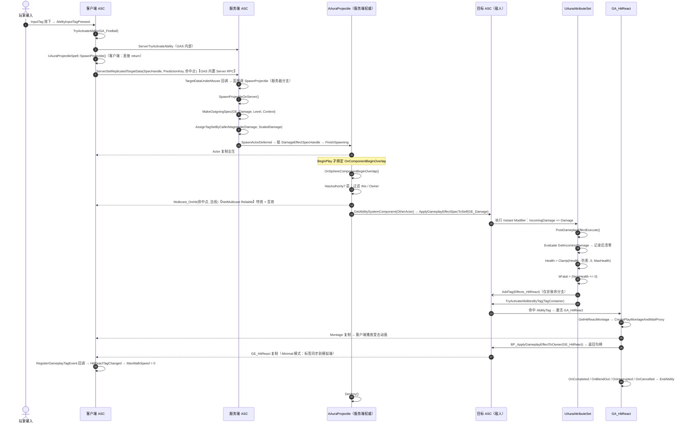

# 敌人受击（HitReact）时序图

_客户端 / 服务端泳道 · RPC 与复制 · AURA / UE5 GAS_

## ① 主时序（Mermaid）



## ② 谁在哪一端执行

| 环节 | 函数 | 执行端 | 传输方式 |
|---|---|---|---|
| 输入 → 激活技能 | `AbilityInputTagPressed` → `TryActivateAbility` | 客户端预测 + 服务端 | `ServerTryActivateAbility` |
| 生成投射物 | `SpawnProjectile` → `SpawnProjectileOnServer` | 客户端直接 return，服务器端实体 | 落点走 `ServerSetReplicatedTargetData`（GAS 内置） |
| 命中特效/音效 | `Multicast_OnHit_Implementation` | 所有端 | NetMulticast Reliable |
| 伤害 GE | `ApplyGameplayEffectSpecToSelf` | **仅服务端** | Instant GE 不预测 |
| 属性结算 | `PostGameplayEffectExecute` | **仅服务端** | — |
| 血量刷新 | `OnRep_Health` → 血条 Widget | 客户端 | 属性复制 |
| 受击标签 | `AddTag(Effects_HitReact)` | 服务端产生 → 复制 | Minimal 模式同步标签 |
| 受击动画 | `AbilityTask_PlayMontageAndWait` | 服务端驱动 + 客户端播放 | Montage 复制 |
| 停步 | `HitReactTagChanged` | 标签变化的所有端 | — |
| 销毁投射物 | `Destroy()` | 服务端 | Actor 销毁复制 |

## ③ 时间轴（纯文本版）

```
客户端                                 服务端
  │ 输入                                  │
  ├─ TryActivate(GA_FireBall) ───────────┼─▶ ServerTryActivateAbility
  │                                      │
  ├─ SpawnProjectile（直接 return）       │
  ├─ ServerSetReplicatedTargetData ──────┼─▶ TargetDataUnderMouse 回调
  │   （GAS 内置，携带命中点）            │    └─ 蓝图再调 SpawnProjectile
  │                                      │       └─ SpawnProjectileOnServer
  │                                      │          ├─ MakeOutgoingSpec(GE_Damage)
  │                                      │          ├─ SetByCaller(Damage)
  │                                      │          └─ SpawnActorDeferred → FinishSpawning
  │                                      │
  ◀──────── Actor 复制 ──────────────────┤ Projectile 存在
                               │
                               ├─ OnBeginOverlap
                               │   ├─ Multicast_OnHit ──▶ 所有客户端播特效
                               │   ├─ ApplyGameplayEffectSpecToSelf(GE_Damage)
                               │   ├─ PostGameplayEffectExecute
                               │   │    ├─ IncomingDamage → 0
                               │   │    ├─ Health -= dmg（Clamp）
                               │   │    └─ AddTag(Effects.HitReact)
                               │   ├─ TryActivateAbilitiesByTag
                               │   │    └─ GA_HitReact
                               │   │        ├─ PlayMontageAndWait ─▶ 客户端播动画
                               │   │        └─ ApplyGEToOwner(GE_HitReact)
                               │   └─ Destroy
                               │
  ◀──── Health 属性复制 ───────┤ OnRep_Health → 头顶血条
  ◀──── Effects.HitReact ──────┤ HitReactTagChanged → MaxWalkSpeed = 0
```

## ④ 时序上的四个关键点

- **先表现后结算**：`Multicast_OnHit` 在 `ApplyGameplayEffectSpecToSelf` 之前（AuraProjectile.cpp:161 早于 :167），所以特效不会因为 GE 结算异常而丢失
- **句柄先于 Overlap**：`SpawnActorDeferred` 里先赋 `DamageEffectSpecHandle` 再 `FinishSpawning`，否则 BeginPlay 绑定的 Overlap 可能在句柄为空时被触发
- **Instant GE 不预测**：`PostGameplayEffectExecute` 只在服务端跑，客户端看到的血量完全依赖 `Health` 属性复制，所以客户端血条有 1 个 RTT 的延迟
- **受击动画不在扣血同帧结束**：`EndAbility` 挂在 Montage 的四条回调上，动画时长决定技能存活期

## ⑤ 需要在 PIE 里核对的顺序问题

- **只允许一处生成**：`SpawnProjectile` 客户端分支已改为直接 return，客户端不再发额外请求；服务器端那份技能实例（Local Predicted）收到 target data 后走服务器分支生成。核对方法：`SpawnProjectileOnServer` 打断点，远程客户端放一次技能应只进一次；若进两次，检查蓝图里是否还有别的项目调用了生成口
- **同帧多目标**：投射物没有 `bHit` 标志（AuraProjectile.cpp:120-124），一个 Tick 内命中多个目标会连续结算并多次 `Destroy()`，观察 `PostGameplayEffectExecute` 断点次数
- **标签是否常驻**：`GE_HitReact` 是 Infinite 且 `GA_HitReact` 里没移除，观察 `Effects.HitReact` 的 `NewCount` 是否在动画结束后回到 0——目前预期是**回不去**
- **致命一击**：`bFatal` 为 true 时不加标签、不激活受击技能（走的是 else 分支），所以打死敌人**不会播受击动画**，也没有死亡表现
