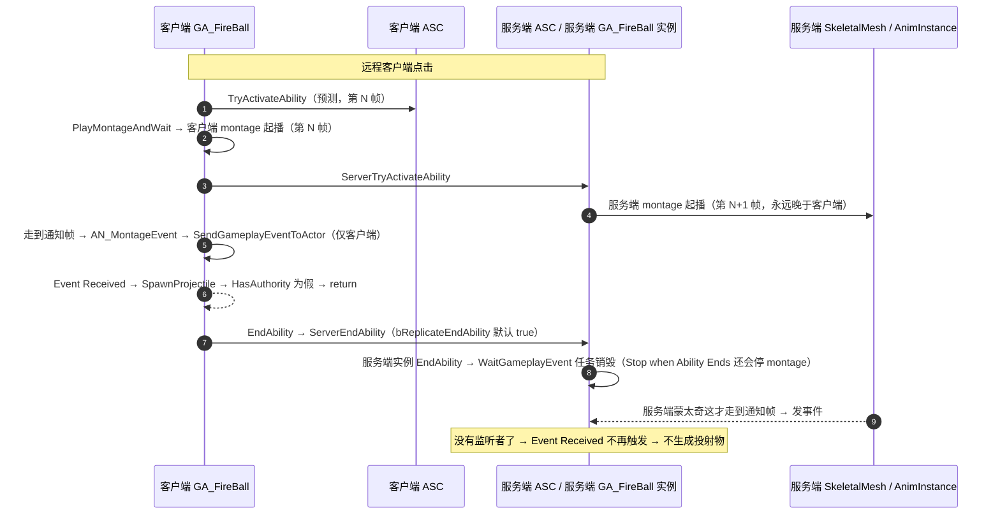

# 踩坑：火球卡在 WaitGameplayEvent —— 远程客户端点击不生成投射物

_GA_FireBall 蓝图链 · AnimNotify → GameplayEvent → SpawnProjectile · AURA / UE5.8 GAS_

> 状态：**根因已定位，修复方案未实施**。本文只记录结论与验证手段，代码/蓝图尚未改动。

## ① 现象

| 操作 | 客户端表现 | 服务端表现 |
|---|---|---|
| 主机（ListenServer 本机）按输入 | 蒙太奇播放，火球飞出 | 有投射物 Actor |
| 远程客户端按输入 | 蒙太奇播放，**没有火球** | **没有投射物 Actor** |
| 远程客户端，把 `Spawn Projectile` 挪到 `WaitGameplayEvent` 之前 | 正常 | 正常 |

蓝图链（GA_FireBall）：

```
UpdateFacingTarget → PlayMontageAndWait(AM_Cast_FireBolt)
  → WaitGameplayEvent(Event.Montage.FireBall, Only Match Exact ✔)
  → Spawn Projectile → End Ability
```

## ② 一句话根因

**客户端预测的那份技能实例提前 `EndAbility`，把服务端同一份实例一起结束了，服务端名下的 `WaitGameplayEvent` latent task 随之销毁；等服务端自己的蒙太奇走到通知帧时，已经没有人接收这个事件。**

客户端那次 `SpawnProjectile` 本身是无害的空转（无权限早退），所以真正出问题的只有服务端一条线。

## ③ 支撑证据

- **客户端生成是空转**，`Source/Aura/Private/AbilitySystem/Abilities/AuraProjectileSpell.cpp:62`
  ```cpp
  if (!AvatarActor->HasAuthority()) return;
  SpawnProjectileOnServer(ProjectileTargetLocation);
  ```
  → "客户端也没有火球"是设计使然，不是 bug；真正的生成点只有服务端。
- **通知是无网络判断的本地调用**：`Content/Blueprint/AnimNotifies/AN_MontageEvent.uasset` 的 `Received_Notify`
  只连了 `GetOwner → SendGameplayEventToActor(Owner, EventTag, Payload)`，`Event Tag = Event.Montage.FireBall`，
  没有 `HasAuthority` / `Switch Has Authority` 之类的分支。
  → GameplayEvent **不跨网络复制**：哪一端 tick 到了 AnimNotify，事件就只落在哪一端的 ASC 上。
- **蒙太奇上的通知实例**：`Content/Assets/Characters/Aura/Animations/Abilities/AM_Cast_FireBolt.uasset`
  的 Notifies 里挂的就是 `AN_MontageEvent`，Event Tag 同为 `Event.Montage.FireBall`，与事件节点一致。
- **端到端复制开关**：`UGameplayAbility::bReplicateEndAbility` 默认 `true`，
  Local Predicted 技能在客户端 `EndAbility` 会走 `ServerEndAbility`，服务端那份实例被一起结束。

### 不是这些原因（排查时排除过的）

- 不是标签不匹配：通知的 `Event Tag` 与 `WaitGameplayEvent` 的 tag 同为 `Event.Montage.FireBall`，且主机点击能触发。
- 不是 `ProjectileClass` / `DamageEffectClass` 未配置：主机点击能正常生成。
- 不是目标点没同步：目标点由 `TargetDataUnderMouse` 走 `ServerSetReplicatedTargetData`，服务端有自己的值。
- 不是事件节点没连上：服务端在"把 `Spawn Projectile` 提前"的版本里能走到生成，说明链本身通。

## ④ 时序（为什么主机行、客户端不行）



```
F 视角（帧）           客户端                服务端
N       TryActivate / montage 起播
N+1                            ServerTryActivateAbility → montage 起播
N+k                            （仍在演播）
N+k    notify → event → spawn(空转) → EndAbility
       ─────── ServerEndAbility ──▶  net tick 先于 anim tick 处理
N+k+1                          实例结束 → task 销毁
N+k+1                          anim tick 才派发 notify → 无人接收
```

- 客户端预测时间线**永远领先服务端约一个往返**，所以"客户端先 EndAbility"不是竞态，而是稳定复现。
- 主机点击时两端是同一个线程：notify 先到 → 生成 → 才 `EndAbility`，所以一切正常。
- 把 `Spawn Projectile` 提前之所以有效，是因为**不再要求服务端先等到事件**：两端一激活就生成，服务端在 `EndAbility` 之前已经 `SpawnActor` 完成。

## ⑤ 端侧职责表

| 环节 | 在哪一端跑 | 是否跨网络 |
|---|---|---|
| `PlayMontageAndWait`（起播） | 客户端预测 + 服务端各跑一次 | 客户端播放不通知服务端；服务端播放会复制给客户端（`RepAnimMontageInfo`） |
| 蒙太奇 `AN_MontageEvent` 通知 | 各自播到那一刻的那一端 | ❌ AnimNotify 不复制，各端独立派发 |
| `SendGameplayEventToActor` | 通知所在端 | ❌ GameplayEvent 不复制，纯本机 |
| `WaitGameplayEvent` | 各自技能实例 | 只监听**本机** ASC |
| `SpawnProjectile` | 两端都调 | 客户端 `HasAuthority()` 早退，只有服务端真生成 |
| `EndAbility` | 客户端预测 + 服务端，且客户端会关掉服务端 | `ServerEndAbility` |
| 投射物本身 | 服务端生成 | Actor 复制 + `SetReplicateMovement` |

## ⑥ 验证方法（待执行）

两处 Print String，各打一行，先确认"哪一端丢的"：

1. `AN_MontageEvent` 的 `Received_Notify`：打印 `Get Net Mode` + `Has Authority`；
2. `WaitGameplayEvent` 的 `Event Received`：打印 `Get Net Mode`。

预期：

- 主机点击 → 服务端那行出现，并走到 `Spawn Projectile`；
- 远程客户端点击（当前版本）→ 只有客户端那行；服务端那行**根本不出现**（能力已被结束，task 已销毁）；
- 远程客户端点击（把 `End Ability` 挪到 `On Completed` 之后）→ 服务端那行出现，火球生成。

## ⑦ 修复方案

**① 推荐：不要把 `End Ability` 挂在事件链上。**
`Event Received → Spawn Projectile` 到此为止；`PlayMontageAndWait` 的 `On Completed`（或 `On Blend Out`）→ `End Ability`。
两端蒙太奇都完整播完，客户端结束的时刻远晚于服务端通知帧，服务端的 `WaitGameplayEvent` 必定收到事件。

**② 接受"激活即发射"：**
`Spawn Projectile` 放在 `PlayMontageAndWait` 之后、`WaitGameplayEvent` 之前（已验证可行），事件节点只做表现或直接删掉，`End Ability` 同样挂 `On Completed`。代价是生成时机与动画帧不同步。

**③ 一定要服务端在通知帧生成：**
不要指望"客户端播蒙太奇 → 本地发事件 → 服务端收到"。要由 RPC 驱动：notify 里判断端，客户端调 ASC 上的 Server RPC，服务端收到后再 `SendGameplayEventToActor` 或直接调 `SpawnProjectileOnServer`。
工作区里曾有一个 `UAuraAbilitySystemComponent::ServerSpawnProjectile(const FGameplayAbilitySpecHandle, const FVector&)`，现在已被删干净（`Source/Aura/Public/AbilitySystem/AuraAbilitySystemComponent.h` 与同名 `.cpp` 都已无 `ServerSpawnProjectile` 符号，只能从 git 历史里翻回来）。它当时带的"只接受服务端上确实处于激活中的实例"的校验值得保留——恢复时别退化成裸 RPC。

## ⑧ 顺带要修的

- **`Stop when Ability Ends` 是勾着的**：事件一到就 `EndAbility`，会让蒙太奇在发射瞬间被掐断，动作看起来"卡一下"。方案 ① 之后自然消失。
- **注释与实现矛盾**：`Source/Aura/Public/AbilitySystem/Abilities/AuraProjectileSpell.h:36` 写"远程客户端对应的那份技能实例在服务器上也会走到这里"——只在服务端那条执行链没有被客户端提前打断时成立，正是本坑。
- **服务端动画不 tick 的次级风险**（DedicatedServer 必踩）：服务端收事件的前提是它自己的 `AnimInstance` 真的 tick 到了通知帧；`USkeletalMeshComponent` 默认按可见性裁剪动画更新，专用服务器没有渲染，AnimNotify 不可靠。**不要把权威逻辑建立在蒙太奇通知上**，这也是方案 ③ 的价值。

## ⑨ 通用规则（下次直接套）

1. GAS 的 `GameplayEvent` 是**本机事件**；`AnimNotify` 是**各端独立派发**的。两者拼在一起 = "谁播谁发"，不会跨端。
2. 权威逻辑（`SpawnActor`、扣血、加标签）只能由**服务端自己的时间线**或**RPC**驱动；客户端的蒙太奇进度对服务端不可见。
3. Local Predicted 技能的 `EndAbility` 会**连带结束服务端的实例**并销毁其 latent task；`EndAbility` 的时机必须晚于所有"服务端还要等"的事件。
4. 客户端预测的时间线稳定领先服务端一个 RTT——"客户端先做、服务端后做"的顺序在联网下是**确定的**，不是偶发竞态。
